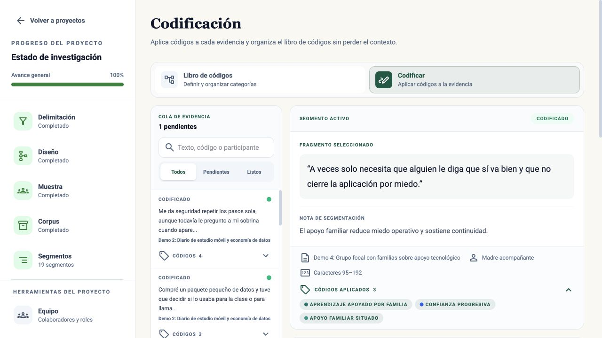

# Desarrollo de una experiencia de usuario para orientar la formulación y el análisis en investigaciones antropológicas cualitativas para la Universidad del Valle de Guatemala

**Proyecto de Graduación 2026 · Universidad del Valle de Guatemala**

## Descripción

Este proyecto es el frontend de una plataforma que guía a quien investiga durante una investigación antropológica cualitativa, desde que plantea el estudio hasta que analiza sus resultados. En un mismo lugar se define el proyecto, se organiza el corpus y se interpreta el material. Cada hallazgo se puede rastrear hasta los memos, códigos y segmentos que lo respaldan.

**Este trabajo de graduación abarca solo el desarrollo del frontend.** El backend y la API de la plataforma no forman parte de esta entrega.

Por eso la interfaz funciona de dos formas:

- **Demo local.** Se hizo para que cualquiera pueda entrar al programa y recorrerlo sin tener que conectar una API. Usa un estudio ficticio guardado en memoria y no necesita base de datos, claves ni otro servicio.
- **Modo conectado.** El frontend sí está preparado para trabajar con la API real del proyecto, que maneja las sesiones, guarda los datos y responde las consultas del asistente Jack. Solo hay que indicarle la dirección de la API.

[Aplicación publicada](https://antropologia.vercel.app/login) · [Repositorio original del proyecto](https://github.com/Hayser8/Antropologia)

## Tecnologías utilizadas

| Tecnología | Para qué se usa |
|---|---|
| Next.js 16.2.6 y React 19.2.3 | Rutas, pantallas y componentes de la interfaz. |
| Tailwind CSS 4 y CSS | Estilos y distribución de los paneles según el ancho de la pantalla. |
| Jest y TypeScript | Pruebas de la lógica del cliente y revisión de tipos. |
| Playwright y axe-core | Recorridos en navegador, navegación con teclado, revisión visual y accesibilidad. |

## Requisitos previos

- **Node.js 22** (la entrega se probó con la versión 22.17.1) y npm.
- Conexión a internet la primera vez, porque las fuentes y los iconos se cargan desde Google Fonts.
- Solo para el modo conectado: una instancia de la [API del proyecto](https://github.com/Hayser8/Antropologia) en ejecución y una cuenta válida en ella.
- Solo para las pruebas de navegador: OpenSSL y los navegadores de Playwright.

## Instalación

1. Clonar el repositorio.

   ```sh
   git clone https://github.com/GraduacionesUVG/2026-22210-garcia-orellana-sofia-isabel.git
   cd 2026-22210-garcia-orellana-sofia-isabel
   ```

2. Instalar las dependencias. Todos los comandos del proyecto se ejecutan desde `src/`.

   ```sh
   cd src
   npm ci
   ```

La demo no necesita variables de entorno. Para el modo conectado, ver el paso de configuración más abajo.

## Ejecución

### Demo local con datos ficticios

```sh
npm run demo
```

Abrir [el acceso local](http://localhost:3000/login) e ingresar con **demo@example.test** y la contraseña **Antropologia2026!**. Son credenciales de prueba que solo existen en la demo local. En el panel de proyectos, abrir **Memoria y cuidados en Las Jacarandas**, que trae dos documentos, seis segmentos y tres códigos. [Recorrido de la demo](src/demo/README.md)

**Los cambios de la demo se pierden al detenerla.** Todo se guarda en la memoria del proceso local. Se puede cerrar la pestaña y volver a entrar mientras el proceso siga activo. Al detenerlo con `Ctrl+C` y volver a ejecutar `npm run demo`, regresan los datos iniciales.

### Frontend conectado a la API

1. Tener la API del proyecto en ejecución. Si corre en la misma computadora, debe usar un puerto distinto al del frontend.
2. Desde `src/`, crear el archivo de variables con `cp -n .env.example .env.local` y configurar los dos orígenes. [Plantilla de variables](src/.env.example)

   ```dotenv
   NEXT_PUBLIC_APP_URL=http://localhost:3000
   BACKEND_ORIGIN=http://localhost:3317
   ```

   `NEXT_PUBLIC_APP_URL` es la dirección de la interfaz. `BACKEND_ORIGIN` es la dirección de la API, con protocolo y puerto, sin agregar `/api`.
3. Si la demo está corriendo, detenerla con `Ctrl+C` para liberar el puerto. Ejecutar `npm run conectado`, abrir [el acceso local](http://localhost:3000/login) e iniciar sesión con una cuenta de esa API.

En este modo, iniciar sesión, abrir proyectos y guardar cambios depende de que la API esté disponible. [Detalles de conexión](src/conexion/README.md)

### Compilación de producción

Desde `src/`, ejecutar `npm run build`. La misma compilación sirve para los dos modos: `npm run start:demo` usa los datos ficticios y `npm start` usa la API configurada. Si cambia la dirección de la interfaz, hay que actualizar `NEXT_PUBLIC_APP_URL` y volver a compilar.

## Recorrido de la aplicación

1. **Formular el proyecto.** Desde el panel de proyectos se abre el espacio de investigación. En Delimitación se describe el tema, el contexto y la población. En Diseño se escriben la pregunta y los objetivos. En Muestra se eligen el enfoque, el alcance y las técnicas de recolección.
2. **Preparar el corpus.** Cada documento guarda una transcripción con su tipo de fuente, participante y notas de contexto. En Segmentos se selecciona un fragmento del texto y se conserva su posición dentro del documento.
3. **Codificar y explorar.** El libro de códigos organiza las categorías en un árbol. Al codificar se ve la cita y su nota antes de asignarle códigos. La matriz y la red de coocurrencias muestran qué códigos aparecen juntos y con qué evidencia.
4. **Interpretar y reportar.** Los memos conectan una interpretación con documentos o códigos. Los hallazgos guardan su evidencia y su estado de revisión. El reporte resume el avance del proyecto y permite descargar los resultados. Desde Equipo se manejan las invitaciones y los roles.

En cada etapa hay una guía metodológica con ejemplos, señales de calidad y acceso a las versiones anteriores.



## Estructura del repositorio

| Carpeta | Contenido |
|---|---|
| [`capturas/`](capturas/) | 17 capturas de pantalla de la aplicación. |
| [`demo/`](demo/) | Video demostrativo del proyecto. |
| [`docs/`](docs/) | Informe final y consentimiento firmado. |
| [`src/frontend/`](src/frontend/) | La interfaz: pantallas, componentes, estilos y pruebas. Es la misma para los dos modos. |
| [`src/demo/`](src/demo/) | Datos ficticios y funciones que simulan las respuestas de la API en memoria. |
| [`src/conexion/`](src/conexion/) | Conector HTTP que reenvía las solicitudes a la API real. |

Dentro del frontend, cada módulo (delimitación, diseño, muestra, corpus, análisis, reporte y equipo) tiene su carpeta en [features/projects](src/frontend/features/projects/) con sus componentes, hooks y funciones de apoyo. Las pruebas están en [frontend/\_\_tests\_\_](src/frontend/__tests__/).

## Pruebas

Todos los comandos se ejecutan desde `src/`.

| Comando | Qué comprueba |
|---|---|
| `npm test` | Pruebas unitarias del frontend, de la demo, del conector y de la selección de modo. |
| `npm run test:unit` | Los 257 casos de la interfaz con Jest. |
| `npm run test:demo` | Cuentas, proyectos, metodología, corpus, equipo, codificación y exportaciones con datos ficticios. |
| `npm run test:conexion` y `npm run test:modos` | El reenvío de solicitudes y qué fuente de datos atiende la sesión en cada modo. |
| `npm run typecheck` | Los tipos del proyecto. |
| `npx playwright install chromium firefox webkit` y luego `npm run test:ui` | Las pruebas de navegador con respuestas preparadas. |

La entrega incluye 28 archivos de pruebas unitarias y 29 de navegador. La ejecución completa de Playwright sigue pendiente en un entorno que permita iniciar los tres navegadores.

## Capturas

Las 17 capturas están en [`/capturas`](capturas/). Se tomaron en la aplicación publicada con una cuenta de demostración y siguen el orden de un proyecto, desde el inicio de sesión hasta el reporte. Los documentos y hallazgos que aparecen son ficticios.

| Pantalla | Qué se observa |
|---|---|
| [01 · Inicio de sesión](capturas/captura-01.jpg) | Formulario de acceso a la plataforma. |
| [02 · Panel de proyectos](capturas/captura-02.jpg) | Búsqueda de un proyecto por nombre y resumen de los resultados. |
| [03 · Navegación del proyecto en tableta](capturas/captura-03.jpg) | Avance general, etapa actual y acceso a las herramientas del equipo. |
| [04 · Delimitación del proyecto](capturas/captura-04.jpg) | Tema, contexto y población del estudio junto a la evaluación de la delimitación. |
| [05 · Diseño de la investigación](capturas/captura-05.jpg) | Pregunta de investigación y objetivos, con las observaciones del panel de revisión. |
| [06 · Configuración de la muestra en tableta](capturas/captura-06.jpg) | Enfoque etnográfico, alcance interpretativo y selección de técnicas. |
| [07 · Ficha de un documento del corpus](capturas/captura-07.jpg) | Grupo focal con fuente, alias de participante, extensión y nota de contexto. |
| [08 · Búsqueda en la transcripción](capturas/captura-08.jpg) | Coincidencia de la palabra «teléfono» dentro del texto del grupo focal. |
| [09 · Selección de un segmento](capturas/captura-09.jpg) | Fragmento resaltado en el texto y su posición dentro del documento. |
| [10 · Libro de códigos](capturas/captura-10.jpg) | Árbol con las categorías y sus subcódigos. |
| [11 · Codificación de un segmento](capturas/captura-11.jpg) | Cita activa, nota de segmentación, documento de origen y tres códigos aplicados. |
| [12 · Red de coocurrencias](capturas/captura-12.jpg) | El tamaño de cada nodo indica la frecuencia del código y el grosor de las líneas, cuántos segmentos comparten dos códigos. |
| [13 · Matriz de coocurrencias](capturas/captura-13.jpg) | Cruce de «Confianza progresiva» y «Aprendizaje apoyado por familia», con los segmentos que respaldan la relación. |
| [14 · Vínculos de un memo](capturas/captura-14.jpg) | Nota metodológica vinculada a un documento y al código «Microprácticas domésticas». |
| [15 · Bitácora de hallazgos](capturas/captura-15.jpg) | Una tensión en revisión y un patrón confirmado, con su nivel de confianza y evidencia. |
| [16 · Colaboración y permisos del equipo](capturas/captura-16.jpg) | Formulario de invitación y permisos de los roles de propietario, editor y lectura. |
| [17 · Reporte y cierre del proyecto](capturas/captura-17.jpg) | Síntesis de cuatro documentos, 19 segmentos, 18 códigos, cuatro memos y tres hallazgos. |

## Demo

El video demostrativo está en [`/demo/demo.mp4`](demo/demo.mp4). Dura 4:54 y recorre la aplicación publicada con narración, desde el inicio de sesión hasta el reporte y el área del equipo.

## Documentación

| Documento | Ubicación |
|---|---|
| Informe final | [`/docs/informe_final.pdf`](docs/informe_final.pdf) |
| Consentimiento de uso de foto y video firmado | [`/docs/consentimiento_firmado.pdf`](docs/consentimiento_firmado.pdf) |

> **Nota sobre el informe final.** Al informe aún le falta la firma de un evaluador. Este archivo se actualizará en cuanto se tenga la versión con todas las firmas.

## Autora

- Sofía Isabel García Orellana - 22210

## Licencia

El frontend de esta entrega no declara una licencia de software propia. Las dependencias de terceros conservan sus propias licencias.
